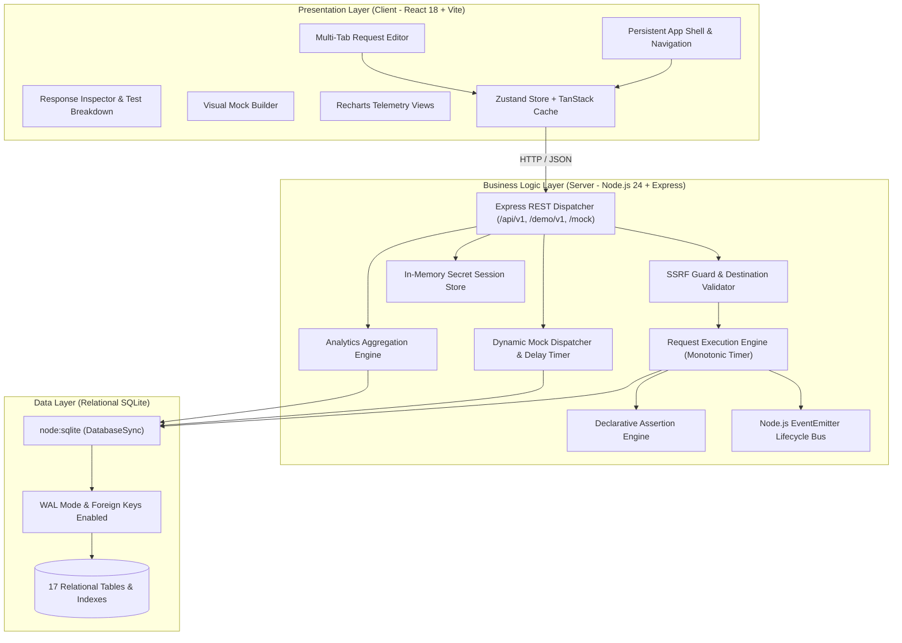
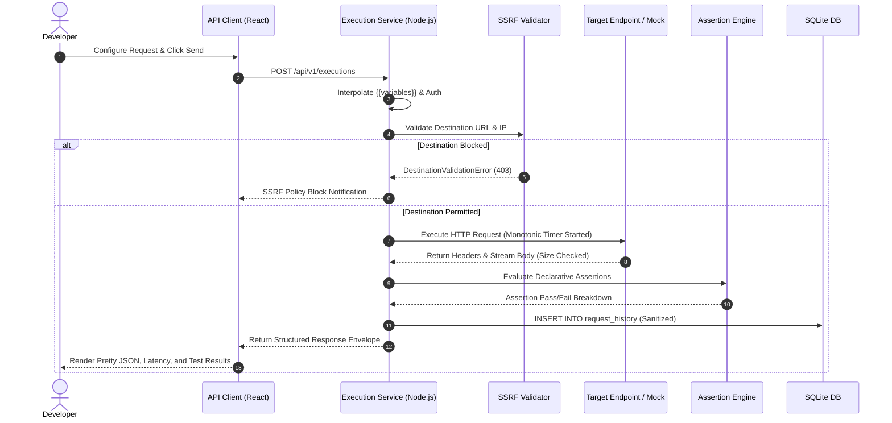
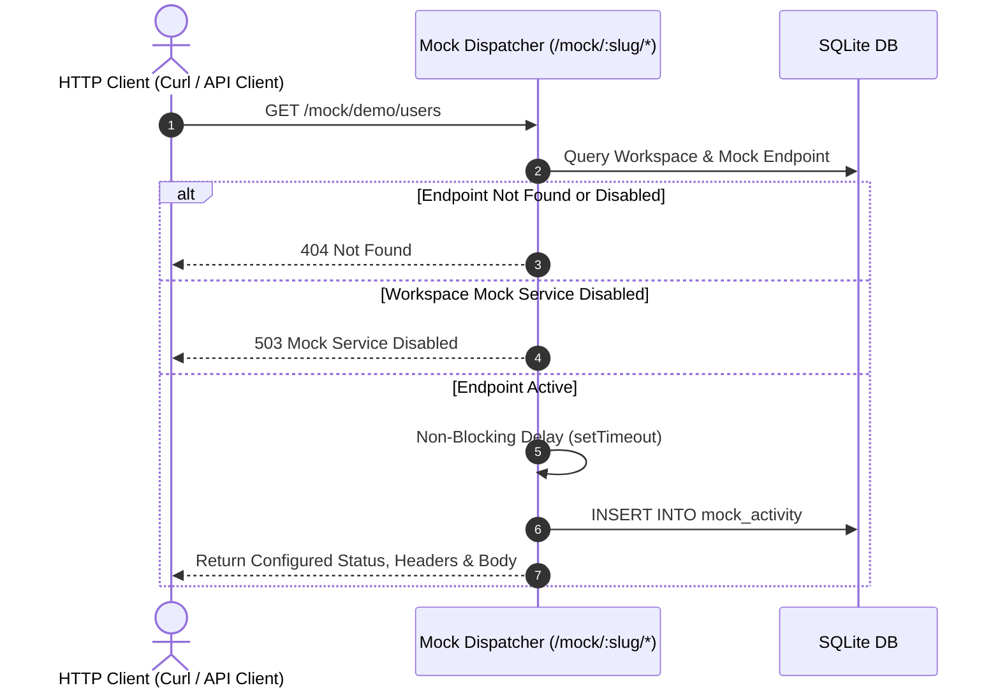

# API FORGE — System Architecture & Design

## 1. Architectural Philosophy

API FORGE is engineered around three core principles:
1. **Local-First Reliability**: Zero external database servers, cloud tokens, or network dependencies are required for core execution.
2. **Defensive Outbound Security**: Executing user-defined HTTP requests requires strict destination validation to eliminate Server-Side Request Forgery (SSRF).
3. **Transparent Demonstrability**: Every telemetry metric, assertion result, and latency reading is calculated from real SQLite execution records and monotonic timers rather than simulated data.

---

## 2. Three-Tier Modular Architecture

---

## 3. Core Component Responsibilities

### 3.1 Presentation Layer (`client/src/`)
- **Persistent App Shell**: Houses the collapsible sidebar, breadcrumb topbar with live health ping, command palette (`Ctrl+K`), and status bar.
- **API Client Module**: Multi-tab request builder, query parameter editor, header management, body editors (JSON, Plain Text, URL-encoded), authentication selector, and response viewer.
- **Mock Server Manager**: Visual builder for mock endpoints, delay sliders, and real-time mock activity stream.
- **Demonstration CRUD View**: Interactive data table for the student management REST API with live search and pagination.
- **Test Suites & Collection Runner**: Declarative assertion management, sequential collection runner with progress tracking, and detailed pass/fail breakdown.
- **Analytics & History**: Interactive Recharts visualizations and filterable execution audit trail.

### 3.2 Business Logic Layer (`server/src/`)
- **`requestExecutionService.js`**: Orchestrates outbound HTTP requests. Resolves environment variables, enforces timeouts with `AbortController`, streams response bodies with hard size caps (5MB), and measures latency using `performance.now()`.
- **`ssrfValidator.js`**: Enforces outbound request security. In Local Demonstration Mode, restricts calls to loopback ports matching the server; blocks cloud metadata (`169.254.169.254`), private IP subnets, and recursive management API calls.
- **`assertionEngine.js`**: Evaluates assertions against response status, duration, size, headers, and JSON body paths without using `eval()` or `Function()`.
- **`mockDispatchService.js`**: Intercepts requests on `/mock/:workspaceSlug/*`, matches enabled database endpoints, applies non-blocking simulated latency via `setTimeout`, and logs activity.
- **`secretStore.js`**: Process memory `Map` holding active session secrets, ensuring secret values never leak to database files or exports.
- **`analyticsService.js`**: Executes real SQL aggregation queries for total requests, success rates, latency percentiles (min, max, mean, median, p95), status code distributions, and endpoint frequencies.

### 3.3 Data Layer (`server/src/database/`)
- Utilizes Node.js 24 native `node:sqlite` (`DatabaseSync`).
- Foreign key constraints enforced via `PRAGMA foreign_keys = ON;`.
- Write-Ahead Logging enabled via `PRAGMA journal_mode = WAL;` for high-throughput concurrent reads.
- Versioned migrations in `migrations/` tracked by the `schema_migrations` table.

---

## 4. Key Request Lifecycles

### 4.1 Outbound Request Execution Flow

### 4.2 Dynamic Mock Endpoint Resolution Flow

