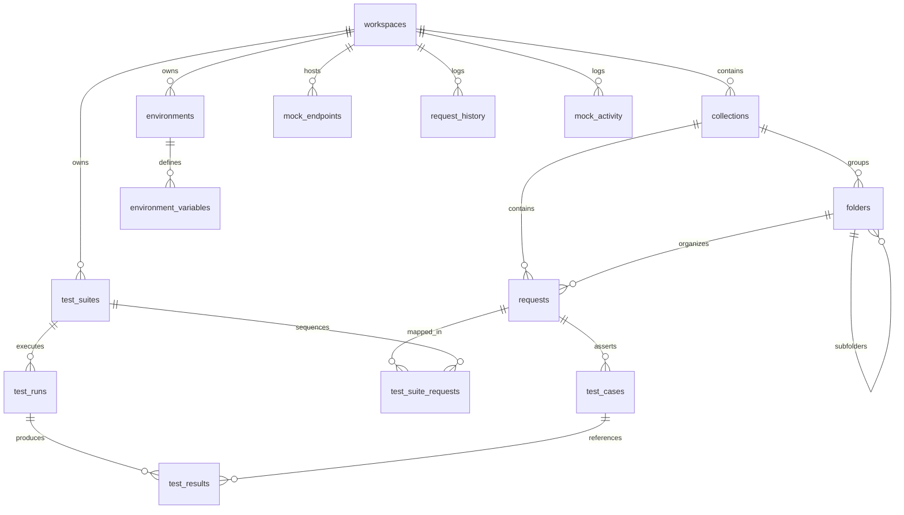

# API FORGE — Database Architecture & Schema Specification

## 1. Overview & Engine Specification

- **Database Engine**: SQLite 3
- **Driver**: Node.js 24 native `node:sqlite` (`DatabaseSync`)
- **Storage Location**: `./data/apiforge.sqlite`
- **Integrity Enforcement**: `PRAGMA foreign_keys = ON;`
- **Journal Mode**: `PRAGMA journal_mode = WAL;` (Write-Ahead Logging for non-blocking concurrent reads)
- **Timestamps**: Stored as UTC ISO-8601 strings (`datetime('now', 'utc')`)

---

## 2. Entity-Relationship (ER) Diagram

---

## 3. Relational Table Specifications

### 1. `workspaces`
Primary tenant container for organizing projects, mock endpoints, and telemetry.
- `id` (TEXT, PK): Unique identifier (`ws-...`).
- `name` (TEXT, NOT NULL): Workspace display name.
- `slug` (TEXT, NOT NULL, UNIQUE): URL slug for mock endpoints (`/mock/:slug/*`).
- `description` (TEXT): Optional workspace notes.
- `mock_service_enabled` (INTEGER, NOT NULL, DEFAULT 1): Master kill switch for workspace mock endpoints.
- `created_at` (TEXT), `updated_at` (TEXT).

### 2. `collections`
Groups related API requests.
- `id` (TEXT, PK): Unique identifier (`col-...`).
- `workspace_id` (TEXT, NOT NULL, FK -> `workspaces.id` ON DELETE CASCADE).
- `name` (TEXT, NOT NULL): Collection name.
- `description` (TEXT): Purpose of collection.
- `created_at` (TEXT), `updated_at` (TEXT).

### 3. `folders`
Hierarchical folders within a collection.
- `id` (TEXT, PK): Unique identifier (`fld-...`).
- `collection_id` (TEXT, NOT NULL, FK -> `collections.id` ON DELETE CASCADE).
- `parent_folder_id` (TEXT, NULLABLE, FK -> `folders.id` ON DELETE CASCADE).
- `name` (TEXT, NOT NULL): Folder label.
- `sort_order` (INTEGER, DEFAULT 0).
- `created_at` (TEXT).

### 4. `requests`
Persistent saved HTTP requests.
- `id` (TEXT, PK): Unique identifier (`req-...`).
- `collection_id` (TEXT, NOT NULL, FK -> `collections.id` ON DELETE CASCADE).
- `folder_id` (TEXT, NULLABLE, FK -> `folders.id` ON DELETE SET NULL).
- `name` (TEXT, NOT NULL): Request title.
- `description` (TEXT).
- `method` (TEXT, NOT NULL, CHECK: `GET`, `POST`, `PUT`, `PATCH`, `DELETE`, `HEAD`, `OPTIONS`).
- `url_template` (TEXT, NOT NULL): Target URL containing potential `{{variables}}`.
- `headers_json` (TEXT, DEFAULT `'[]'`): JSON array of headers `{ key, value, enabled }`.
- `query_params_json` (TEXT, DEFAULT `'[]'`): JSON array of query parameters.
- `body_type` (TEXT, DEFAULT `'none'`, CHECK: `none`, `json`, `text`, `urlencoded`).
- `body_template` (TEXT): Raw payload string with variable interpolation support.
- `auth_configuration_json` (TEXT, DEFAULT `'{"type":"none"}'`): Non-secret auth structure.
- `request_settings_json` (TEXT, DEFAULT `'{}'`).
- `sort_order` (INTEGER, DEFAULT 0).
- `created_at` (TEXT), `updated_at` (TEXT).

### 5. `environments`
Contexts for environment variable sets.
- `id` (TEXT, PK): Unique identifier (`env-...`).
- `workspace_id` (TEXT, NOT NULL, FK -> `workspaces.id` ON DELETE CASCADE).
- `name` (TEXT, NOT NULL): Environment label (e.g. `Local Development`).
- `created_at` (TEXT), `updated_at` (TEXT).

### 6. `environment_variables`
Key-value pairs for environment interpolation.
- `id` (TEXT, PK): Unique identifier (`var-...`).
- `environment_id` (TEXT, NOT NULL, FK -> `environments.id` ON DELETE CASCADE).
- `variable_key` (TEXT, NOT NULL).
- `variable_value` (TEXT, NULLABLE): Stored in database for non-secrets; NULL for secrets.
- `is_secret` (INTEGER, DEFAULT 0): When 1, live values are stored in process memory only.
- `is_enabled` (INTEGER, DEFAULT 1).
- `UNIQUE(environment_id, variable_key)`.

### 7. `mock_endpoints`
Locally hosted REST mock endpoints.
- `id` (TEXT, PK): Unique identifier (`mock-...`).
- `workspace_id` (TEXT, NOT NULL, FK -> `workspaces.id` ON DELETE CASCADE).
- `name` (TEXT, NOT NULL): Endpoint display name.
- `description` (TEXT).
- `method` (TEXT, NOT NULL, CHECK: `GET`, `POST`, `PUT`, `PATCH`, `DELETE`, `HEAD`, `OPTIONS`).
- `endpoint_path` (TEXT, NOT NULL): Route relative path (e.g. `/users`).
- `response_status` (INTEGER, DEFAULT 200).
- `response_headers_json` (TEXT, DEFAULT `'{"Content-Type": "application/json"}'`).
- `response_body` (TEXT, DEFAULT `'{}'`).
- `content_type` (TEXT, DEFAULT `'application/json'`).
- `delay_ms` (INTEGER, DEFAULT 0, CHECK: 0 to 10000).
- `is_enabled` (INTEGER, DEFAULT 1).
- `created_at` (TEXT), `updated_at` (TEXT).
- `UNIQUE(workspace_id, method, endpoint_path)`.

### 8. `test_suites`
Named suites grouping requests for automated execution.
- `id` (TEXT, PK), `workspace_id` (TEXT, FK), `name` (TEXT), `description` (TEXT), `created_at` (TEXT), `updated_at` (TEXT).

### 9. `test_suite_requests`
Join table sequencing requests within a test suite.
- `id` (TEXT, PK), `test_suite_id` (TEXT, FK), `request_id` (TEXT, FK), `execution_order` (INTEGER).

### 10. `test_cases`
Declarative assertions attached to saved requests.
- `id` (TEXT, PK), `request_id` (TEXT, FK), `name` (TEXT), `assertion_type` (TEXT), `assertion_target` (TEXT), `expected_value_json` (TEXT), `is_enabled` (INTEGER), `sort_order` (INTEGER), `created_at` (TEXT), `updated_at` (TEXT).

### 11. `test_runs`
Header record for a test suite execution.
- `id` (TEXT, PK), `test_suite_id` (TEXT, NULLABLE FK), `workspace_id` (TEXT, FK), `started_at` (TEXT), `completed_at` (TEXT), `total_assertions` (INTEGER), `passed_assertions` (INTEGER), `failed_assertions` (INTEGER), `skipped_assertions` (INTEGER), `execution_status` (TEXT).

### 12. `test_results`
Individual assertion result rows belonging to a test run.
- `id` (TEXT, PK), `test_run_id` (TEXT, FK), `test_case_id` (TEXT, NULLABLE FK), `assertion_name_snapshot` (TEXT), `result_status` (TEXT), `expected_value_sanitized` (TEXT), `actual_value_sanitized` (TEXT), `failure_message_sanitized` (TEXT), `created_at` (TEXT).

### 13. `request_history`
Audit log of all executed outbound requests.
- `id` (TEXT, PK), `workspace_id` (TEXT, FK), `request_id` (TEXT, NULLABLE FK), `collection_id` (TEXT, NULLABLE FK), `method` (TEXT), `sanitized_url` (TEXT), `status_code` (INTEGER, NULLABLE), `response_time_ms` (REAL), `response_size_bytes` (INTEGER), `execution_status` (TEXT), `request_source` (TEXT), `error_category` (TEXT), `passed_assertions` (INTEGER), `failed_assertions` (INTEGER), `created_at` (TEXT).

### 14. `mock_activity`
Audit log of incoming calls to mock endpoints.
- `id` (TEXT, PK), `workspace_id` (TEXT, FK), `mock_endpoint_id` (TEXT, NULLABLE FK), `method` (TEXT), `sanitized_path` (TEXT), `status_code` (INTEGER), `response_time_ms` (REAL), `created_at` (TEXT).

### 15. `students`
Data store for the demonstration Student Management REST API.
- `id` (INTEGER, PRIMARY KEY AUTOINCREMENT).
- `name` (TEXT, NOT NULL).
- `email` (TEXT, NOT NULL, UNIQUE).
- `department` (TEXT, NOT NULL).
- `year` (INTEGER, NOT NULL, CHECK: 1 to 5).
- `created_at` (TEXT), `updated_at` (TEXT).

### 16. `app_settings`
Platform configuration key-value store.
- `setting_key` (TEXT, PRIMARY KEY), `setting_value_json` (TEXT), `updated_at` (TEXT).

### 17. `schema_migrations`
Tracks applied database migrations.
- `version` (TEXT, PRIMARY KEY), `applied_at` (TEXT).

---

## 4. Performance Indexes

- `idx_workspaces_slug` ON `workspaces(slug)`
- `idx_collections_workspace` ON `collections(workspace_id)`
- `idx_requests_collection` ON `requests(collection_id)`
- `idx_mock_endpoints_workspace` ON `mock_endpoints(workspace_id)`
- `idx_mock_lookup` ON `mock_endpoints(workspace_id, method, endpoint_path, is_enabled)`
- `idx_history_workspace` ON `request_history(workspace_id)`
- `idx_history_created_at` ON `request_history(created_at)`
- `idx_students_email` ON `students(email)`
